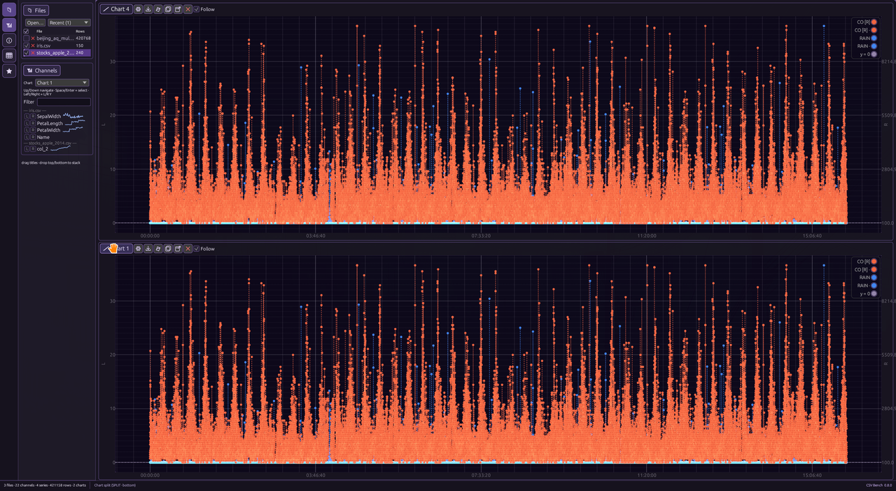

# Chart-Bench

Fast multi-file channel graphing for instrumentation and control dumps — **CSV · Excel · Parquet · MATLAB · MF4 · WITSML · SQLite**, **100% Rust**, **egui + egui_plot**.

## Why Chart-Bench

Engineers in instrumentation and control often sit on piles of data files with huge channel counts. Most charting UIs bog down there — weak at massive channel sets, awkward with multi-file overlays, and slow when you just need to get series on a plot.

**Chart-Bench** is built for that job: a fast multi-file channel handler. Preview channels into charts, combine files on the same axes, dual Y when scales disagree, keep chart options simple, and save complete sessions (files + charts + axis assignments) for one-click restore next time.

Written in Rust so it stays fast and efficient. Few tools handle many files and huge channel sets this way.

## Features

- **Huge channel sets** — open dumps with large channel counts; filter and sparkline-preview before you plot
- **Multi-file overlays** — combine series from many files on the same charts
- **Preview → chart** — drag channels onto plots (Shift / ←→ for left vs right axis)
- **Dual Y-axes** — overlay series with different scales without fighting the UI
- **Simple chart options** — toolbar for options, Save PNG, Export CSV, clear / duplicate / pop-out
- **Complete sessions** — files, charts, and axis assignments saved together; one-click restore
- **Named presets** — reuse layouts across similar runs
- **Formats** — CSV / TSV, Excel (XLS/XLSX, all non-empty sheets), Parquet (SNAPPY/GZIP/ZSTD/LZ4/BROTLI; full-row load up to ~10 GiB), MATLAB `.mat`, MDF/MF4, WITSML wellLog XML, SQLite (tables as datasets with timestamp autodetection)
- **Follow mode** — watch growing CSV files as they are written
- **Multi-chart layouts** — stacked / side-by-side tiles with nested layouts

## Screenshots

Chart toolbar (Options · Save PNG · Export CSV · …):



Nested tile layouts:


Save PNG captures the full plot widget (axes + scales). Chart background color fills the plot and axis chrome; grid and tick ink follow luminance — faded dark ink on light fills, quiet light ink on dark fills.

## Downloads

Prebuilt **v0.8.0** packages: [GitHub Releases](https://github.com/unipsycho/chart-bench/releases/tag/v0.8.0)

| Asset | Notes |
|------|--------|
| `chart-bench-0.8.0-windows-x86_64-portable.zip` | Portable Windows (`chart-bench.exe`) |
| `chart-bench-0.8.0-x86_64-unknown-linux-gnu.tar.gz` | Portable Linux binary (glibc ≥ 2.31 / Debian 11+) |
| `chart-bench_0.8.0_amd64.deb` | Debian / Ubuntu (`/usr/bin/chart-bench`) |
| `chart-bench-0.8.0-1.x86_64.rpm` | Fedora / RHEL-like (`/usr/bin/chart-bench`) |
| `SHA256SUMS` | Checksums for the above |

```bash
# Debian / Ubuntu
sudo dpkg -i chart-bench_0.8.0_amd64.deb

# Fedora / RHEL-like
sudo rpm -i chart-bench-0.8.0-1.x86_64.rpm

# Portable Linux
tar -xzf chart-bench-0.8.0-x86_64-unknown-linux-gnu.tar.gz
./chart-bench
```

## Build / run

Requires a recent Rust toolchain (edition 2021, rust-version 1.74+).

```bash
git clone https://github.com/unipsycho/chart-bench.git
cd chart-bench
cargo run --release
```

Then click **Demo CSV**, or Open / drop files onto the window.

```bash
cargo test --lib
```

Binary: `target/release/chart-bench`.

### Live Follow demo

```bash
# terminal A
./scripts/grow_demo.sh samples/live_growing.csv
# in the app: Open that file, tick Follow
```

## Layout

Compact top bar: Open / Demo / New chart + panel toggles + layout.

Panels: Files · Channels · central Charts · Info · Saved/Presets · optional Table.

Each chart toolbar: Options · Save PNG · Export CSV · Clear · Duplicate · Pop-out · Remove.

## Samples

Tiny demos live in [`samples/`](samples/). Parquet fixtures: [`samples/parquet/`](samples/parquet/). Huge soak-test CSVs are kept out of git (see `samples/README.md`).

## Docs

- Decisions: [`PROJECT.md`](PROJECT.md)
- Gaps: [`GAPS.md`](GAPS.md)
- Todos: [`TODO.md`](TODO.md)
- Open planning notes: [`docs/planning/`](docs/planning/)
- Sample catalog: [`samples/README.md`](samples/README.md)

## License

Licensed under either of

- Apache License, Version 2.0 ([LICENSE-APACHE](LICENSE-APACHE)), or
- MIT license ([LICENSE-MIT](LICENSE-MIT))

at your option.
