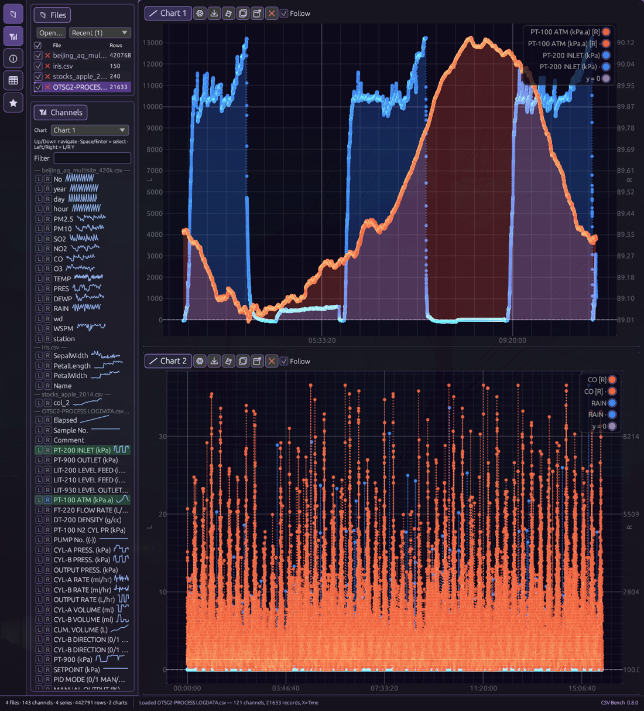

# csv-bench

Desktop workbench for **CSV / XLS(X) / Parquet** graphing — **100% Rust**, **egui + egui_plot**.

Open dumps fast, preview channels, drag onto charts, dual Y-axes, multi-chart layouts, session autosave, and Follow mode for growing files.

## Screenshots

Chart toolbar (Options · Save PNG · Export CSV · …):


Nested tile layouts:



Save PNG captures the full plot widget (axes + scales). Chart background color fills the plot and axis chrome; grid and tick ink follow luminance — faded dark ink on light fills, quiet light ink on dark fills.

## Downloads

Prebuilt **v0.8.0** packages: [GitHub Releases](https://github.com/unipsycho/csv-bench/releases/tag/v0.8.0)

| Asset | Notes |
|------|--------|
| `csv-bench-0.8.0-windows-x86_64-portable.zip` | Portable Windows (`csv-bench.exe`) |
| `csv-bench-0.8.0-x86_64-unknown-linux-gnu.tar.gz` | Portable Linux binary (glibc ≥ 2.31 / Debian 11+) |
| `csv-bench_0.8.0_amd64.deb` | Debian / Ubuntu |
| `csv-bench-0.8.0-1.x86_64.rpm` | Fedora / RHEL-like |
| `SHA256SUMS` | Checksums for the above |

```bash
# Debian / Ubuntu
sudo dpkg -i csv-bench_0.8.0_amd64.deb

# Fedora / RHEL-like
sudo rpm -i csv-bench-0.8.0-1.x86_64.rpm

# Portable Linux
tar -xzf csv-bench-0.8.0-x86_64-unknown-linux-gnu.tar.gz
./csv-bench
```

## Build / run

Requires a recent Rust toolchain (edition 2021, rust-version 1.74+).

```bash
git clone https://github.com/unipsycho/csv-bench.git
cd csv-bench
cargo run --release
```

Then click **Demo CSV**, or Open / drop files onto the window.

```bash
cargo test --lib
```

Binary: `target/release/csv-bench`.

### Live Follow demo

```bash
# terminal A
./scripts/grow_demo.sh samples/live_growing.csv
# in the app: Open that file, tick Follow
```

## Features

| Area | Status |
|------|--------|
| Multi-line header detect (names/nodes/units) | ✅ |
| Auto time column → X, else index | ✅ |
| CSV + XLSX import (all non-empty sheets → `file.xlsx :: Sheet`) | ✅ |
| Parquet ingest (SNAPPY + UNCOMPRESSED; clear error otherwise) | ✅ |
| Channels panel + sparklines + filter | ✅ |
| Drag channel → chart (Shift = right axis) | ✅ |
| Multi-series egui_plot + legend + hover | ✅ |
| Dual axis (linked X, stacked L/R plots) | ✅ |
| Multi-chart stacked / side-by-side | ✅ |
| Files **New chart** (plain-text control) | ✅ |
| Chart toolbar **Save PNG** (full widget: axes + scales) | ✅ |
| Luminance-based grid / scale contrast | ✅ |
| Info panel stats / spacing / gaps | ✅ |
| Table preview | ✅ |
| Session autosave | ✅ |
| Named presets | ✅ |
| Follow growing CSV (`notify`) | ✅ |
| Export chart CSV | ✅ |
| OS file drop onto window | ✅ |

## Layout

Compact top bar: Open / Demo / New chart + panel toggles + layout.

Panels: Files · Channels · central Charts · Info · Saved/Presets · optional Table.

Each chart toolbar: Options · Save PNG · Export CSV · Clear · Duplicate · Pop-out · Remove.

## Samples

Tiny demos live in [`samples/`](samples/). Parquet fixtures: [`samples/parquet/`](samples/parquet/). Huge soak-test CSVs are kept out of git (see `samples/README.md`).

## Docs

- Decisions: [`PROJECT.md`](PROJECT.md)
- Gaps: [`GAPS.md`](GAPS.md)
- Todos: [`TODO.md`](TODO.md)
- Planning notes: [`docs/planning/`](docs/planning/)

## License

Licensed under either of

- Apache License, Version 2.0 ([LICENSE-APACHE](LICENSE-APACHE)), or
- MIT license ([LICENSE-MIT](LICENSE-MIT))

at your option.
